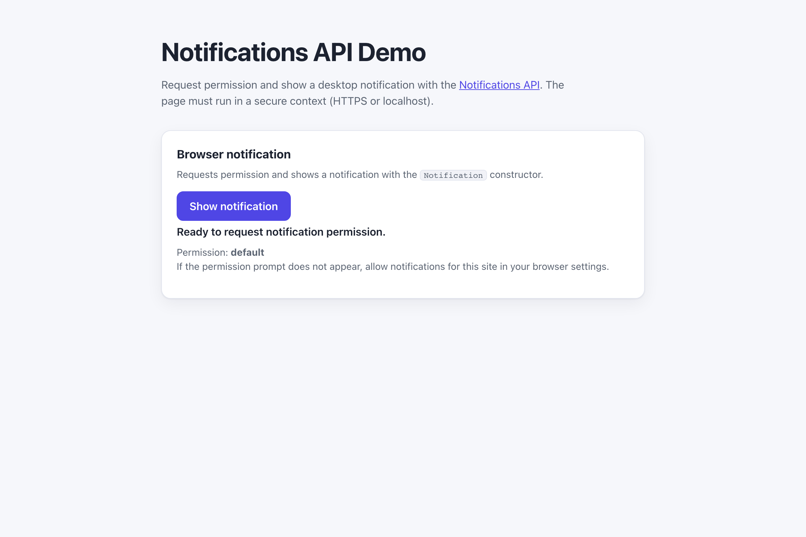

# WebSharper.Notifications

[](https://github.com/dotnet-websharper/NotificationsAPI)

WebSharper bindings for the [Notifications API](https://developer.mozilla.org/en-US/docs/Web/API/Notifications_API) —
showing desktop notifications from F# and C# web apps.

The Notifications API is only available in [secure contexts](https://developer.mozilla.org/en-US/docs/Web/Security/Defenses/Secure_Contexts)
(HTTPS or localhost), and the browser asks for permission before showing a notification.

This repository contains:

| Project | Purpose |
| --- | --- |
| `WebSharper.Notifications` | The binding: WIG definitions for `Notification`, `NotificationOptions`, `NotificationAction`, `NotificationEvent`, and the `NotificationPermission` / `NotificationDir` enums. |
| `WebSharper.Notifications.Sample` | An ASP.NET Core SPA that requests permission and shows a notification. |

## Live demos

**Try it live:** [Open the sample in your browser](https://dotnet-websharper.github.io/NotificationsAPI/)



The sample doubles as the binding's test case: it calls `Notification.requestPermission()` and shows a notification
when permission is granted.

- **Sample (this repository):** <https://dotnet-websharper.github.io/NotificationsAPI/>
- **Source repository:** <https://github.com/dotnet-websharper/NotificationsAPI>
- **WebSharper bindings:** <https://websharper.com/bindings>

## Features

- `Notification.requestPermission()` and `Notification.permission`.
- `Notification` with `title`, `body`, `icon`, `badge`, `image`, `tag`, `data`, `dir`, `lang`, `timestamp`, `vibrate`, `renotify`, `requireInteraction`, and `silent`.
- `NotificationOptions` and `NotificationAction` (`action`, `title`, `icon`).
- `NotificationEvent` with the `notification` and `action` fields.
- `onclick`, `onclose`, `onerror`, and `onshow` handlers (plus the `OnClick` / `OnClose` / `OnError` / `OnShow` aliases).

## Installation

The binding is not currently published to NuGet. Reference the projects from source:

```bash
git clone https://github.com/dotnet-websharper/NotificationsAPI.git
```

```xml
<ItemGroup>
  <ProjectReference Include="path/to/WebSharper.Notifications/WebSharper.Notifications.fsproj" />
</ItemGroup>
```

## Usage

```fsharp
namespace WebSharper.Notifications.Demo

open WebSharper
open WebSharper.JavaScript
open WebSharper.Notifications

[<JavaScript>]
module Demo =
    let requestNotification () =
        promise {
            let! permission = Notification.RequestPermission()
            if permission = "granted" then
                let _ = new Notification("Hello! Notifications are enabled.", NotificationOptions(
                    Body = "This is a test notification."
                ))
                Console.Log("Notification sent.")
            else
                Console.Log("Notifications denied.")
        }
```

`Notification.RequestPermission()` returns a `Promise<string>`. Compare the result to `"granted"`, `"denied"`, or
`"default"`.

## Running the sample

Build the sample in Release and serve its static output:

```bash
dotnet build WebSharper.Notifications.Sample/WebSharper.Notifications.Sample.fsproj -c Release
python3 -m http.server -d WebSharper.Notifications.Sample/wwwroot 8099
```

Open <http://localhost:8099/> and click **Show notification**. Grant the permission when the browser prompts for it.

Alternatively, run the ASP.NET Core host:

```bash
dotnet run --project WebSharper.Notifications.Sample
```

## Building from source

### Prerequisites

- [.NET SDK 10](https://dotnet.microsoft.com/download) or later.

### Build

```bash
dotnet build WebSharper.Notifications.sln -c Release
```

The binding projects target `netstandard2.0`; the sample targets `net10.0`.

## Deployment

Pushing to `main` triggers `.github/workflows/ghpages.yml`, which builds the sample in Release and publishes
`WebSharper.Notifications.Sample/wwwroot` to the `gh-pages` branch.

## Repository layout

```
WebSharper.Notifications/              # binding (WIG definitions)
  Main.fs
WebSharper.Notifications.Sample/       # ASP.NET Core SPA demo
  Client.fs
  Startup.fs
  wwwroot/
    index.html
    site.css
.github/workflows/ghpages.yml          # build + deploy the sample to GitHub Pages
```

## Notes on the API

- **Secure context:** the Notifications API is only exposed in secure contexts. Serve the page over HTTPS or from
  localhost.
- **Permissions:** request permission from a user gesture. If the prompt does not appear, allow notifications for
  the site in the browser settings.
- **Notification actions:** `NotificationOptions.actions` and `NotificationEvent` are not available on every
  platform. The binding keeps the types; handle missing support gracefully.
- **Service worker:** `ServiceWorkerRegistration.showNotification()` is the recommended path for persistent
  notifications; the binding covers the `Notification` constructor used here.

## License

Apache 2.0 — see [LICENSE.md](LICENSE.md).
